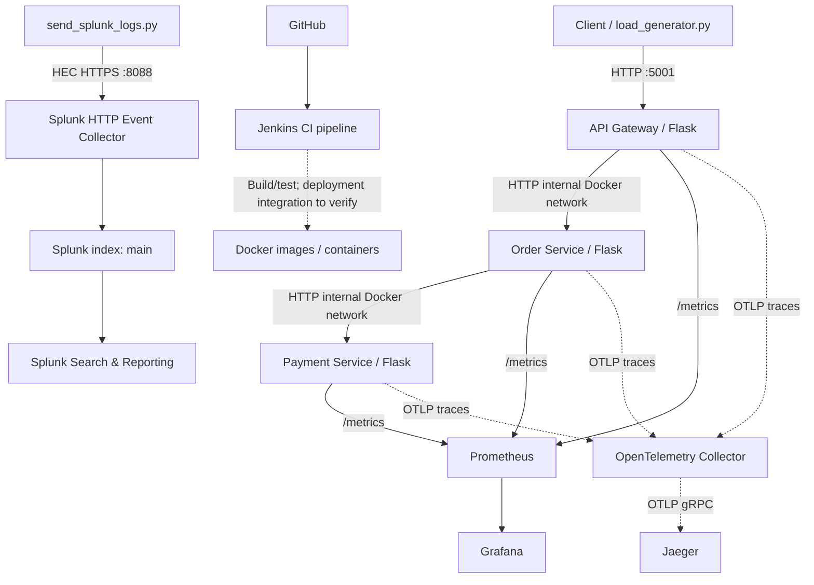
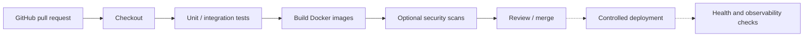

# SRE Observability Lab

A hands-on Site Reliability Engineering laboratory for learning **microservices, containerization, continuous integration, traffic generation, metrics, logging, distributed tracing, and incident troubleshooting**.

> **Documentation status:** This README is based on the architecture and commands used during development of the lab. Some folders appear in the repository but their implementations have not been inspected here. Those are explicitly marked **verify in repository**. A successful health check does not prove that metrics, traces, logs, or deployment automation work end to end.

## 1. Why this project exists

Production SRE work requires understanding a request across multiple services, not merely checking whether a process is running. This lab provides a small system in which you can deliberately create traffic and failures, then investigate:

- **Availability:** Are the services reachable and returning successful responses?
- **Traffic:** How many requests per second reach each service?
- **Errors:** Which endpoint or dependency is producing 5xx responses?
- **Latency:** How long does a request take, and where is the time spent?
- **Changes:** Can application updates be built, tested, and deployed safely?
- **Observability:** Can we correlate metrics, logs, and traces to understand incidents?

The application is intentionally small so infrastructure behavior is easier to study.

## 2. Architecture at a glance



**Solid arrows** represent request paths or integrations exercised in the lab. **Dashed arrows** indicate instrumentation/integration paths that must be verified in the current checkout. In particular, the Python Splunk script produces **synthetic events**; it does **not** yet forward the actual Flask container logs.

### Important ports

| Component | Local address | Purpose |
|---|---|---|
| API Gateway | `http://localhost:5001` | Entry point to application |
| Order Service | `http://localhost:5002` | Order API; calls payment service |
| Payment Service | `http://localhost:5003` | Payment simulation |
| Jenkins | `http://localhost:8080` | CI job execution and build logs |
| Prometheus | `http://localhost:9090` | Metrics scraping and PromQL |
| Grafana | `http://localhost:3000` | Metrics dashboards |
| Splunk Web | `http://localhost:8000` | Log search, reports, dashboards |
| Splunk HEC | `https://localhost:8088` *if SSL enabled* | Machine-to-machine log ingestion |
| Jaeger | `http://localhost:16686` | Distributed trace exploration |
| OTel Collector | Docker network `otel-collector:4317` / `:4318` | OTLP gRPC / HTTP receivers; not necessarily published to host |

The port mapping is configured in `docker-compose.yml`; check it if your local checkout differs.

## 3. Application services and request lifecycle

### 3.1 API Gateway (`api-gateway/`)

**Why added:** In real systems, clients usually enter through a gateway or edge service rather than calling every backend directly. The gateway provides a convenient place to measure incoming traffic and investigate downstream failures.

**What it does in this lab:**

- Exposes a Flask HTTP service on container port `5000`, published on host port `5001`.
- Provides `GET /health` for a simple liveness check.
- Provides `GET /orders`, which calls `http://order-service:5000/orders` on the Docker network.
- Exposes `GET /metrics` for Prometheus.
- Maintains an application request counter named `api_gateway_requests_total` with `endpoint` and `status` labels (confirmed from the live `/metrics` endpoint).

A `200` health response means the gateway process is responding; it does **not** necessarily establish that its downstream services are healthy.

### 3.2 Order Service (`order-service/`)

**Why added:** A separate downstream service creates a multi-hop dependency, allowing us to practice debugging a request that crosses service boundaries.

**What it does:**

- Runs on container port `5000`, published as host port `5002`.
- Implements `GET /orders` and calls `http://payment-service:5000/pay`.
- Exposes `/health` and `/metrics`.

If payment is slow or fails, the order request can also be affected. The exact response mapping should be confirmed in `order-service/app.py`.

### 3.3 Payment Service (`payment-service/`)

**Why added:** Real incident analysis needs failures, not just healthy responses. The payment service provides a controlled way to observe error propagation and latency.

**What it does:**

- Runs on container port `5000`, published as host port `5003`.
- Exposes `GET /pay`, `/health`, and `/metrics`.
- Simulates variable response times and occasional HTTP 500 errors; the lab implementation was described as approximately a 20% random failure chance.

This is **intentional test behavior**, not a production payment implementation. It does not process real payments.

### 3.4 End-to-end request example

1. A client sends `GET http://localhost:5001/orders`.
2. Docker maps host port `5001` to the API Gateway container's port `5000`.
3. The gateway calls the Order Service by Docker Compose service name, `order-service`.
4. The Order Service calls `payment-service`.
5. The Payment Service returns success or a simulated failure.
6. The upstream services return a response to the client; the precise status propagation depends on the code.
7. Application counters, container logs, and (when correctly configured) trace spans provide evidence about what happened.

Try:

```bash
curl -i http://localhost:5001/health
curl -i http://localhost:5001/orders
curl -i http://localhost:5002/health
curl -i http://localhost:5003/health
```

## 4. Docker and Docker Compose

### Why Docker?

Containers package each service with its Python runtime and dependencies. This reduces differences between developer machines and makes it easy to start, stop, inspect, and rebuild services independently.

### Why Docker Compose?

`docker-compose.yml` defines a multi-container environment: services, networks, environment variables, volumes, and host-port mappings. Compose service names provide internal DNS resolution, so the gateway can call `http://order-service:5000` instead of hardcoding a container IP.

The Flask services have been configured to use prebuilt image tags such as `sre-api-gateway:latest`. **If a service has only an `image:` entry and no `build:` entry, `docker compose up --build` does not rebuild its source code.** Build the images explicitly:

```bash
docker build -t sre-api-gateway:latest ./api-gateway
docker build -t sre-order-service:latest ./order-service
docker build -t sre-payment-service:latest ./payment-service

docker compose up -d --no-deps --force-recreate \
  payment-service order-service api-gateway
```

### Persistent volumes

Named volumes retain state for components such as Jenkins, Grafana, and Splunk. Avoid `docker compose down -v` unless you deliberately want to remove stored data.

### Useful operational commands

```bash
docker compose config --quiet       # Validate Compose syntax
docker compose up -d               # Start defined services
docker compose ps                  # Check running services
docker compose logs --tail=50 api-gateway
docker compose restart api-gateway
docker compose down                # Stop/remove containers, retain named volumes
```

### Troubleshooting example

If a container fails with `exec: "opentelemetry-instrument": executable file not found`, its image does not contain the expected executable. Save the dependency files, rebuild the correct image, and verify:

```bash
docker run --rm --entrypoint sh sre-api-gateway:latest \
  -c 'command -v opentelemetry-instrument || echo NOT_INSTALLED'
```

## 5. Prometheus: metrics and QPS

### Why added?

Logs explain individual events, while metrics efficiently summarize system behavior over time. Prometheus periodically scrapes numeric metrics and stores them as labeled time series. SREs use these for traffic, error-rate, resource-use, and latency monitoring.

### How it works here

The Flask services expose `/metrics` using Python Prometheus instrumentation. Prometheus uses `prometheus/prometheus.yml` to scrape configured targets on the Docker network, typically at a 15-second interval.

Check the targets at `http://localhost:9090/targets`. The `up` metric is `1` when a scrape succeeds and `0` when it fails.

```promql
up
```

### The actual API Gateway counter

The live API Gateway output included:

```text
# HELP api_gateway_requests_total Total requests received by API Gateway
# TYPE api_gateway_requests_total counter
api_gateway_requests_total{endpoint="/orders",status="200"} 8417.0
api_gateway_requests_total{endpoint="/orders",status="500"} 2156.0
```

These are **cumulative counts**, not current QPS. The earlier query `flask_http_request_total` returned no data because that was not the name of the metric exposed by this app.

**Total API Gateway requests per second:**

```promql
sum(rate(api_gateway_requests_total[1m]))
```

**Requests per second by status:**

```promql
sum by (status) (rate(api_gateway_requests_total[1m]))
```

**HTTP 500 percentage:**

```promql
100 *
sum(rate(api_gateway_requests_total{status="500"}[2m]))
/
sum(rate(api_gateway_requests_total[2m]))
```

**Important:** A `rate()` query requires multiple recent counter samples. If the result is empty, check the metric name, target status, scrape interval, and whether enough time has elapsed. Protect production alert queries against a zero denominator.

### Four Golden Signals

| Signal | Question | Lab example |
|---|---|---|
| Latency | How long do requests take? | Instrument duration histogram and query p95/p99; verify whether available |
| Traffic | How much demand exists? | `rate(api_gateway_requests_total[1m])` |
| Errors | What fraction of requests fail? | HTTP 5xx counter rate / total counter rate |
| Saturation | How close are resources to their limits? | CPU, memory, file descriptors; full container metrics require additional collection |

A request counter alone does **not** provide p95 or p99 latency. That requires a suitable histogram or another latency metric.

## 6. Grafana: visualization

### Why added?

Prometheus is excellent for collecting and querying metrics, but dashboards make trends and incidents easier to understand. Grafana connects to Prometheus as a data source and turns PromQL results into panels.

### Suggested dashboard panels

1. **Incoming QPS:** `sum(rate(api_gateway_requests_total[1m]))`
2. **QPS by HTTP status:** `sum by (status) (rate(api_gateway_requests_total[1m]))`
3. **HTTP 500 percentage:** the error-rate expression above
4. **Target availability:** `up`
5. **Process memory:** `process_resident_memory_bytes` (group by appropriate scrape labels)
6. **Latency p95/p99:** add only after confirming an appropriate histogram exists

A dashboard does not create metrics. If a panel says *No data*, first verify that Prometheus itself has the underlying series.

## 7. Splunk: centralized log search

### Why added?

During incidents, an SRE needs detailed evidence: error messages, timestamps, affected services, request IDs, and sometimes client or destination IP addresses. Splunk indexes events so they can be searched with **SPL (Search Processing Language)**.

### Splunk Web versus HEC

- **Splunk Web (`:8000`)** is the browser interface for searching, dashboards, and administration.
- **HTTP Event Collector / HEC (`:8088`)** is an HTTP API for sending events **into** Splunk.
- **The HEC token** authenticates the sending script or collector. It is **not** the Splunk Web admin password.
- **`main`** is the destination index used in this lab.
- **`_json`** is the configured sourcetype, enabling structured JSON fields to be extracted.

### What we configured

In **Settings → Data Inputs → HTTP Event Collector**, we created a token named `sre-lab-logs`, enabled it, selected `_json`, and chose the `main` index. The Python script reads the secret from `SPLUNK_HEC_TOKEN` and POSTs JSON to `/services/collector/event`.

**Never commit the token** into Git, `.py` files, or README examples. If a real token was exposed, rotate it. For a local interactive zsh session:

```bash
read -s "SPLUNK_HEC_TOKEN?Enter Splunk HEC token: "
echo
export SPLUNK_HEC_TOKEN
python3 send_splunk_logs.py
```

The lab script uses a local self-signed TLS configuration when HTTPS is enabled. Disabling certificate validation is acceptable only for controlled local testing; use proper certificate validation in real deployments. If HEC SSL is disabled, the endpoint must use `http://` rather than `https://`.

### What `send_splunk_logs.py` does

The script generates **synthetic events** for the three service names, including fields such as:

```json
{
  "service": "payment-service",
  "src_ip": "192.0.2.10",
  "dest_ip": "203.0.113.20",
  "src_port": 54231,
  "dest_port": 5000,
  "protocol": "HTTP",
  "method": "GET",
  "path": "/pay",
  "status": 500,
  "latency_ms": 850,
  "request_id": "req-25",
  "message": "Request failed"
}
```

The IP ranges `192.0.2.0/24`, `198.51.100.0/24`, and `203.0.113.0/24` are reserved for documentation. They are **not actual clients**. The event source used for the network-style simulation is `sre-lab-network-simulation`.

### Useful SPL queries

**Inspect incoming simulated network events:**

```spl
index=main source="sre-lab-network-simulation"
| table _time service src_ip dest_ip src_port dest_port status latency_ms
```

**Find HTTP 500 errors:**

```spl
index=main sourcetype=_json status=500
| table _time service status message request_id
```

**Count 5xx errors by service:**

```spl
index=main sourcetype=_json status>=500
| stats count as errors by service
| sort - errors
```

**Calculate error percentage:**

```spl
index=main sourcetype=_json
| stats count as total count(eval(status>=500)) as errors by service
| eval error_pct=round(100*errors/total,2)
| table service total errors error_pct
```

**Investigate source IPs associated with errors:**

```spl
index=main source="sre-lab-network-simulation" status>=500
| stats count as errors by src_ip
| sort - errors
```

**Show failures over time:**

```spl
index=main sourcetype=_json status>=500
| timechart span=1m count by service
```

Choose an appropriate search time range. Synthetic log statistics are for learning; they do **not** represent actual service health.

### What's not implemented yet?

Running `send_splunk_logs.py` sends simulated data, **not** Docker stdout/stderr logs. A production-style next step is to configure Fluent Bit, Filebeat, or an OpenTelemetry log pipeline to collect real container logs and forward them to Splunk HEC. That requires configuration, permissions, parsing, and validation.

## 8. OpenTelemetry: vendor-neutral instrumentation

### Why added?

Metrics and logs can tell us a request failed, but it may be difficult to determine **which hop caused the delay**. Distributed tracing links work across services into one request journey. OpenTelemetry provides instrumentation APIs, SDKs, and protocols for collecting this telemetry without tightly coupling application code to one backend.

### Python instrumentation

The lab added dependencies such as:

```text
opentelemetry-distro
opentelemetry-exporter-otlp
opentelemetry-instrumentation-flask
opentelemetry-instrumentation-requests
```

The Docker image command was changed to launch Flask through the `opentelemetry-instrument` CLI. Environment variables identify each service and configure the OTLP exporter:

```yaml
environment:
  OTEL_SERVICE_NAME: api-gateway
  OTEL_EXPORTER_OTLP_ENDPOINT: http://otel-collector:4318
  OTEL_EXPORTER_OTLP_PROTOCOL: http/protobuf
  OTEL_TRACES_EXPORTER: otlp
  OTEL_METRICS_EXPORTER: none
  OTEL_LOGS_EXPORTER: none
```

`OTEL_METRICS_EXPORTER: none` does not disable the existing Prometheus `/metrics` endpoint; these are separate instrumentation paths.

### Traces, spans, and context propagation

- A **trace** represents one end-to-end request.
- A **span** represents a timed operation within the trace, such as an inbound Flask request or an outbound HTTP call.
- A **trace ID** groups related spans across services.
- **Context propagation** passes trace context in HTTP headers so the gateway, order, and payment operations can appear in one trace.

The desired result is a single Jaeger trace with spans for the gateway, order service, and payment service. The actual result must be verified in Jaeger.

## 9. OpenTelemetry Collector and Jaeger

### Why the Collector?

The Collector provides a centralized telemetry pipeline. Applications send OTLP to the Collector; it can receive, process, batch, and export traces to a backend. This keeps the application instrumentation independent of Jaeger-specific configuration.

The lab's `otel/collector-config.yaml` was configured conceptually as:

```yaml
receivers:
  otlp:
    protocols:
      grpc:
        endpoint: 0.0.0.0:4317
      http:
        endpoint: 0.0.0.0:4318
processors:
  batch: {}
exporters:
  otlp:
    endpoint: jaeger:4317
    tls:
      insecure: true
service:
  pipelines:
    traces:
      receivers: [otlp]
      processors: [batch]
      exporters: [otlp]
```

The collector previously started successfully and logged that both OTLP receivers were ready. **That alone does not prove that spans are arriving or being stored in Jaeger.**

### Why Jaeger?

Jaeger is a distributed tracing backend and UI. It lets you select a service, find traces, and inspect a waterfall of spans to locate slow or failing operations.

To validate:

```bash
curl -s http://localhost:5001/orders
docker compose ps jaeger otel-collector
docker compose logs --tail=50 otel-collector
```

Then open `http://localhost:16686`, refresh the service list, select `api-gateway`, and inspect a trace. If no services appear, verify the images contain the instrumentation executable, the OTLP endpoint is reachable, and the Collector exporter is healthy.

## 10. Traffic generation: `load_generator.py`

### Why added?

Monitoring dashboards are difficult to learn without real traffic. The load generator sends repeated HTTP requests to the API Gateway, creating measurable throughput, simulated failures, and traces.

### How it works

- Sends requests to `http://localhost:5001/orders`.
- Uses Python `requests` and a `ThreadPoolExecutor` to allow concurrent in-flight requests.
- Schedules submissions at a target of **100 requests per second**.
- Tracks response status counts, including connection failures.
- Supports a fixed duration or a continuous mode, depending on the current file version.

**Target QPS is not guaranteed completed QPS.** Server capacity, thread-pool saturation, network delays, timeouts, and the Python scheduler can all affect actual throughput. Validate achieved QPS using Prometheus.

### Run it

```bash
python3 -m pip install requests
curl -f http://localhost:5001/health
python3 load_generator.py
```

Start with a short, low-rate test, then increase to 100 QPS. Press **Ctrl+C** to stop. Keep tests on your own local services; do not aim this script at systems you do not own or have permission to test.

### Correlate load with monitoring

1. Start the generator.
2. Open Prometheus and query `sum(rate(api_gateway_requests_total[1m]))`.
3. Compare observed QPS with the configured target.
4. Split traffic by `status` to see the effect of simulated payment failures.
5. Inspect traces in Jaeger if tracing is working.
6. Inspect actual application logs via `docker compose logs`; remember that Splunk currently contains simulated events unless real forwarding is configured.

A separate `load-test.js` also exists in the repository listing. Its implementation and purpose must be verified before describing it as an active part of the test pipeline.

## 11. Jenkins and GitHub: CI/CD

### Why Jenkins?

Manually running tests and building Docker images is repetitive and error-prone. A CI system performs consistent checks when code changes. Jenkins also provides a console log that can be used to diagnose build failures.

### Lab setup

- Jenkins runs in Docker using a custom image (`sre-jenkins-custom:latest` in the earlier setup).
- A `Jenkinsfile` defines the pipeline.
- The lab has exercised Git checkout, build/test steps, and Docker CLI access inside Jenkins.
- The Docker socket was mounted for local lab Docker access; this is **highly privileged** and should not be treated as a secure production default.
- The Docker Compose plugin was previously unavailable inside the Jenkins container, and deployment automation was not fully established.

### CI versus CD

**Continuous Integration (CI):** fetch code, install dependencies, run tests, and build artifacts.

**Continuous Delivery/Deployment (CD):** promote validated artifacts into an environment, verify rollout health, and roll back if necessary. A successful Jenkins build does **not** automatically mean the new version was deployed.

### Recommended pipeline flow



The diagram is a **recommended workflow**, not a claim that every stage is currently implemented in the `Jenkinsfile`.

### Pull request workflow

Use a dedicated feature branch for each change:

```bash
git fetch origin
git switch -c feature/my-change origin/main
git add <specific-files>
git diff --cached --stat
git commit -m "Describe the change"
git push -u origin feature/my-change
```

Create a PR against `main` and review **Files changed** before merging. This is especially important if a branch was created from another feature branch: otherwise the PR may include unrelated changes.

## 12. Other repository components to inspect

The project directory listing also includes the following items. Their exact code/configuration was **not available for inspection in this documentation session**, so the descriptions below explain their general role and how to verify whether they are actually integrated.

| Path | Typical purpose | What to verify |
|---|---|---|
| `k8s/` | Kubernetes manifests for workloads, services, configuration | Which manifests exist, image tags, namespace, readiness/liveness probes, and whether they were deployed |
| `argocd/` | GitOps application definitions and reconciliation | Application YAML, target cluster, sync policy, and whether Argo CD is running |
| `filebeat-values.yaml` | Helm values for a Filebeat log collector | Output destination, enabled inputs, Kubernetes/Docker log paths, secrets, deployment status |
| `actions-runner/` | GitHub Actions self-hosted runner setup | Runner registration, active status, permissions, and workflow usage |
| `inventory-service/` | Additional service | Routes, dependencies, Compose inclusion, metrics, and tests |
| `user-service/` | Additional service | Routes, dependencies, Compose inclusion, metrics, and tests |
| `app/` | Application code or auxiliary service | Entrypoint and whether it is used |
| `Dockerfile.jenkins` | Jenkins container build definition | Installed CLI tools and permissions |
| `Jenkinsfile` | Jenkins pipeline as code | Actual stages, triggers, tests, image builds, deployment |
| `load-test.js` | Potential JavaScript load-test script | Tool/runtime, target, rate, and execution instructions |

Do not assume a directory's presence means the component is deployed or connected to the monitoring stack.

## 13. Getting started from a fresh checkout

### Prerequisites

- Docker Desktop with Compose
- Git
- Python 3 and `requests` for the local load generator
- Enough CPU, RAM, and disk for the monitoring containers
- Local `.env` configuration for required Splunk credentials (do not commit it)

### Start the environment

```bash
# In the repository root
docker compose config --quiet

docker build -t sre-api-gateway:latest ./api-gateway
docker build -t sre-order-service:latest ./order-service
docker build -t sre-payment-service:latest ./payment-service

docker compose up -d
docker compose ps
```

Depending on your Compose configuration, the monitoring stack may need additional environment variables or custom images built first (for example Jenkins). Inspect `docker-compose.yml` and `.env.example` if present.

### Basic smoke tests

```bash
curl -f http://localhost:5001/health
curl -f http://localhost:5002/health
curl -f http://localhost:5003/health
curl -i http://localhost:5001/orders
curl -s http://localhost:5001/metrics | grep api_gateway_requests_total
```

### Validate each observability layer

| Layer | Validation | Success criterion |
|---|---|---|
| Application | `curl /health` | HTTP 200 from each service |
| Docker | `docker compose ps` | Expected containers running |
| Metrics | Prometheus `/targets`, `up` | Target is `UP` and series exist |
| QPS | `rate(api_gateway_requests_total[1m])` | Nonzero when traffic is generated |
| Traces | Jaeger service list and trace view | Multi-service spans for one request |
| Synthetic logs | `python3 send_splunk_logs.py` + SPL | Events visible in `main` |
| Real logs | `docker compose logs` | Flask request/application messages visible |
| CI | Jenkins job and console output | Tests/builds actually run |

## 14. Troubleshooting playbook

### API Gateway does not respond

```bash
docker compose ps api-gateway
docker compose logs --tail=100 api-gateway
curl -v http://localhost:5001/health
```

Check container state, port conflicts, application startup errors, and Docker image freshness.

### `/health` is green but `/orders` fails

Check downstream dependencies separately:

```bash
curl -i http://localhost:5002/orders
curl -i http://localhost:5003/pay
docker compose logs --tail=100 order-service payment-service
```

A random payment failure is expected in this lab; persistent errors may indicate connectivity or application issues.

### Prometheus says “Empty query result”

1. Check the metric name from `/metrics`.
2. Check `http://localhost:9090/targets`.
3. Query the raw counter before `rate()`.
4. Allow at least two scrapes within the range.
5. Generate traffic and rerun the query.

### Splunk shows zero events

1. Confirm that the HEC token is enabled and the global HEC listener is active.
2. Confirm whether the endpoint uses HTTP or HTTPS.
3. Verify `SPLUNK_HEC_TOKEN` is exported and correctly read by Python.
4. Check the script's HTTP response and HEC JSON response.
5. Search `index=main sourcetype=_json` over a suitable time range.
6. Remember that running Docker services does not automatically ingest their logs.

### Jaeger shows no services

1. Confirm `otel-collector` and `jaeger` are running.
2. Verify the instrumentation executable exists in each application image.
3. Confirm service names and OTLP protocol/port settings.
4. Generate requests and inspect Collector and application logs.
5. Check for exporter errors or missing spans.

### Load generator does not start

```bash
ls -l load_generator.py
python3 -m pip show requests
python3 load_generator.py
```

If Python says the file does not exist, create and save it in the repository root. If it runs but Prometheus QPS stays at zero, verify the gateway's metric and scraping configuration.

## 15. Security and operational limitations

This is a **learning environment**, not a production-hardened deployment.

- Do not commit `.env`, HEC tokens, passwords, or credentials.
- Rotate credentials that were exposed in source code or shared output.
- Avoid `ssl._create_unverified_context()` outside local testing.
- Jenkins access to `/var/run/docker.sock` is effectively privileged access to the Docker host.
- Limit service exposure to localhost or trusted networks as appropriate.
- Use proper authentication, authorization, TLS, resource limits, and secrets management before deploying anywhere public.
- Use realistic test data without personal information; the synthetic IPs in this lab are documentation addresses.
- Avoid unbounded load generation against shared systems; observe CPU, memory, and error rates.
- Keep trace/log/metric retention and cardinality under control.

## 16. Current state versus next milestones

| Capability | State based on lab work | Next action |
|---|---|---|
| Three Flask microservices | Health checks succeeded | Add integration tests |
| Docker Compose | Running in local lab | Document exact versions and resource limits |
| Prometheus counter | `api_gateway_requests_total` observed | Build Grafana QPS/error panels |
| Splunk HEC synthetic ingestion | Script reported success | Verify indexed counts and build searches/dashboard |
| IP-address simulation | Script prepared for synthetic IP logs | Confirm latest version and query events |
| OpenTelemetry Collector | Started and receivers were ready | Confirm end-to-end spans in Jaeger |
| Jaeger tracing | UI accessible; trace completeness unverified | Validate 3-service trace |
| Jenkins CI | Local Jenkins configured; deployment details unverified | Inspect Jenkinsfile and add safe deployment stage |
| Continuous 100-QPS load | Generator file added | Measure achieved QPS and concurrency limits |
| Automatic real Docker log forwarding | Not yet verified/implemented | Add and validate a log collector |
| Kubernetes / Argo CD / Filebeat | Repository artifacts exist | Inspect configs and document actual deployments |

## 17. SRE interview explanation

> I built a local microservices observability lab with Python Flask services running in Docker. Requests flow from an API Gateway to an Order Service and then a Payment Service, which intentionally introduces intermittent failures. I use Prometheus to collect application counters and measure live request rate and error percentage, and Grafana to visualize the metrics. I configured Splunk HEC with token-based authentication and a Python event generator to practice structured log ingestion and SPL investigations. I also added OpenTelemetry instrumentation, a Collector, and Jaeger to study distributed tracing across service boundaries. Jenkins and GitHub provide the foundation for CI workflows, while a Python load generator creates traffic for troubleshooting exercises. I'm continuing to validate the end-to-end tracing and automate ingestion of actual container logs.

## 18. Suggested future improvements

1. Collect **real container stdout/stderr** using a log forwarder and send it to Splunk HEC.
2. Add **structured JSON logging** in Flask, with request IDs and trace IDs.
3. Add **request-duration histograms** and Grafana p50/p95/p99 panels.
4. Verify **three-service distributed traces** and correlate them with log request IDs.
5. Add automated integration tests for success, failure, and timeout behavior.
6. Add CI checks for formatting, dependencies, tests, Docker builds, and configuration validation.
7. Add resource limits, safe deployment/rollback, and controlled fault-injection exercises.
8. Audit Kubernetes, Argo CD, Filebeat, and extra service directories, then document their actual integration.

---

**Core lesson:** A service being *up* is only the beginning. SRE observability combines **metrics** (what is changing), **logs** (what happened), and **traces** (where a request spent time), supported by repeatable builds, controlled traffic, and disciplined troubleshooting.
